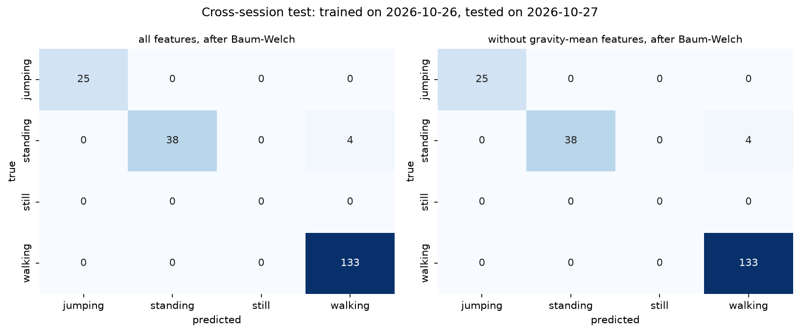
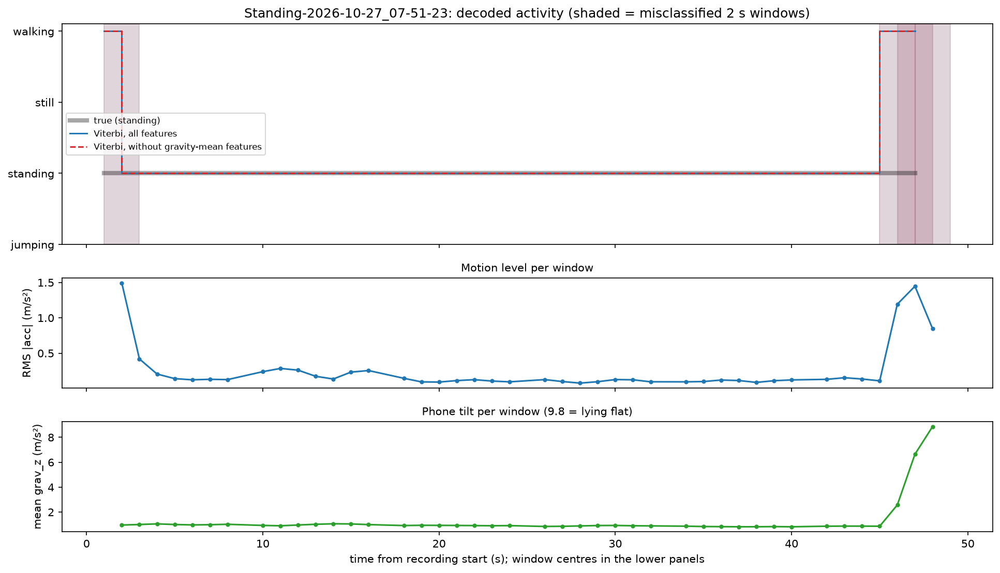

# Cross-session test (unseen session and grip)

**Setup.** The HMM was trained only on the 2026-10-26 session and tested on the 7 recordings made on
2026-10-27, before those were folded into the dataset. The new recordings are a **different session
with a different grip**: every activity has mean gravity ~ (-8, -3, +1), while the training standing
files had ~ (-6.5, -3.5, +6.5). This tests whether the model recognises the activity rather than the
way the phone was held.

* Preprocessing: default 1 s trim at both ends (no trim overrides), 50 Hz, 8 s chunks.
* Train: 31 recordings of 2026-10-26 (standing 18-52-06 excluded; walking
  19-01-46 still included, as it was at the time).
* Test: 7 recordings, each decoded as its own Viterbi sequence (chunks in order).
  Still has no test windows, so its sensitivity is undefined (–).
* Reproduce: `python src/cross_session.py` (recording lists are fixed in the script).

## Summary
<!-- summary -->
Model trained only on the 2026-10-26 session (31 recordings), tested on the 7 recordings of 2026-10-27: **a different session and a different grip** (mean gravity ~ (-8, -3, +1) for every activity; old standing was ~ (-6.5, -3.5, +6.5)). Default 1 s trims, before any trim overrides.
- **all features**: overall accuracy 0.980 (200 windows); sensitivity jumping 1.000, standing 0.905, walking 1.000
- **without gravity-mean features**: overall accuracy 0.980 (200 windows); sensitivity jumping 1.000, standing 0.905, walking 1.000
- All errors are in the new standing file, at t = 1, 45, 46, 47 s (2 s windows; file is ~50 s long): the phone settling at the start and being picked up at the end (motion and tilt jump in those windows), not the standing itself.
- Full details: `reports/cross_session_test.md`.
<!-- /summary -->

## Per recording (after Baum-Welch)

| Features | Activity | Recording | Windows | Correct | Errors predicted as |
|---|---|---|---:|---:|---|
| all features | jumping | `2026-10-27_08-03-12` | 14 | 14 |  |
| all features | jumping | `2026-10-27_08-03-33` | 11 | 11 |  |
| all features | standing | `Standing-2026-10-27_07-51-23` | 42 | 38 | walking 4 |
| all features | walking | `2026-10-27_07-55-32` | 35 | 35 |  |
| all features | walking | `2026-10-27_07-56-24` | 35 | 35 |  |
| all features | walking | `2026-10-27_07-57-13` | 35 | 35 |  |
| all features | walking | `2026-10-27_07-58-00` | 28 | 28 |  |
| without gravity-mean features | jumping | `2026-10-27_08-03-12` | 14 | 14 |  |
| without gravity-mean features | jumping | `2026-10-27_08-03-33` | 11 | 11 |  |
| without gravity-mean features | standing | `Standing-2026-10-27_07-51-23` | 42 | 38 | walking 4 |
| without gravity-mean features | walking | `2026-10-27_07-55-32` | 35 | 35 |  |
| without gravity-mean features | walking | `2026-10-27_07-56-24` | 35 | 35 |  |
| without gravity-mean features | walking | `2026-10-27_07-57-13` | 35 | 35 |  |
| without gravity-mean features | walking | `2026-10-27_07-58-00` | 28 | 28 |  |

## Per-activity metrics

Sensitivity = TP/(TP+FN); specificity = TN/(TN+FP); accuracy = (TP+TN)/all, one-vs-rest.

### all features, before Baum-Welch

| Activity | Windows | Sensitivity | Specificity | Accuracy |
|---|---:|---:|---:|---:|
| jumping | 25 | 1.000 | 1.000 | 1.000 |
| standing | 42 | 0.905 | 1.000 | 0.980 |
| still | 0 | – | 1.000 | 1.000 |
| walking | 133 | 1.000 | 0.940 | 0.980 |

**Overall accuracy: 0.980** (200 windows)

### all features, after Baum-Welch

| Activity | Windows | Sensitivity | Specificity | Accuracy |
|---|---:|---:|---:|---:|
| jumping | 25 | 1.000 | 1.000 | 1.000 |
| standing | 42 | 0.905 | 1.000 | 0.980 |
| still | 0 | – | 1.000 | 1.000 |
| walking | 133 | 1.000 | 0.940 | 0.980 |

**Overall accuracy: 0.980** (200 windows)

### without gravity-mean features, before Baum-Welch

| Activity | Windows | Sensitivity | Specificity | Accuracy |
|---|---:|---:|---:|---:|
| jumping | 25 | 1.000 | 1.000 | 1.000 |
| standing | 42 | 0.905 | 1.000 | 0.980 |
| still | 0 | – | 1.000 | 1.000 |
| walking | 133 | 1.000 | 0.940 | 0.980 |

**Overall accuracy: 0.980** (200 windows)

### without gravity-mean features, after Baum-Welch

| Activity | Windows | Sensitivity | Specificity | Accuracy |
|---|---:|---:|---:|---:|
| jumping | 25 | 1.000 | 1.000 | 1.000 |
| standing | 42 | 0.905 | 1.000 | 0.980 |
| still | 0 | – | 1.000 | 1.000 |
| walking | 133 | 1.000 | 0.940 | 0.980 |

**Overall accuracy: 0.980** (200 windows)

